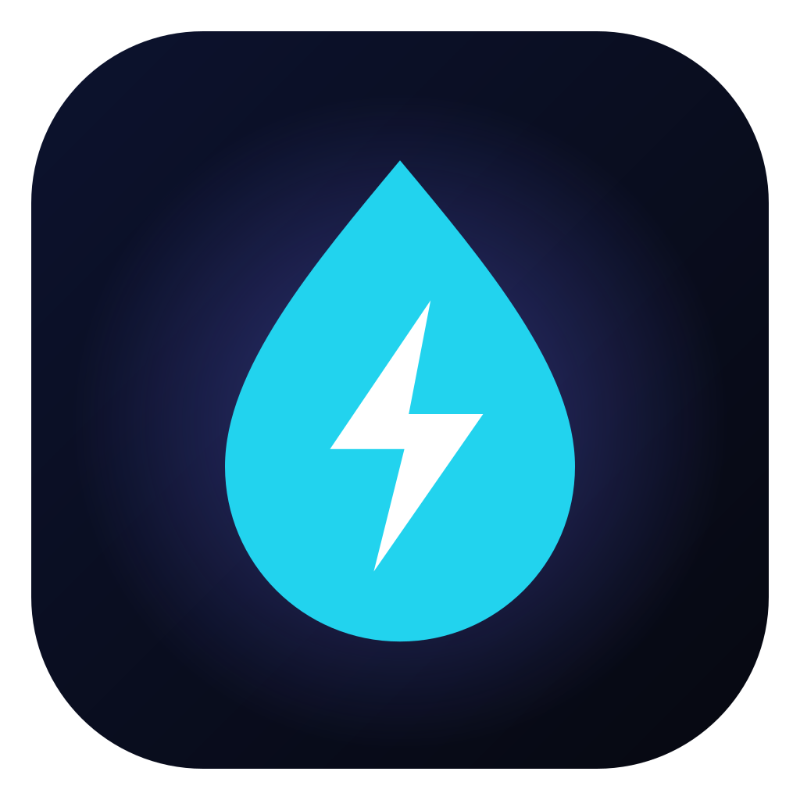
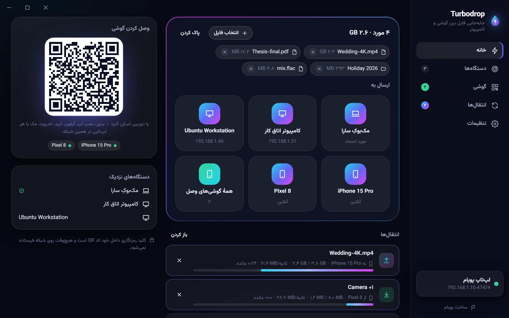
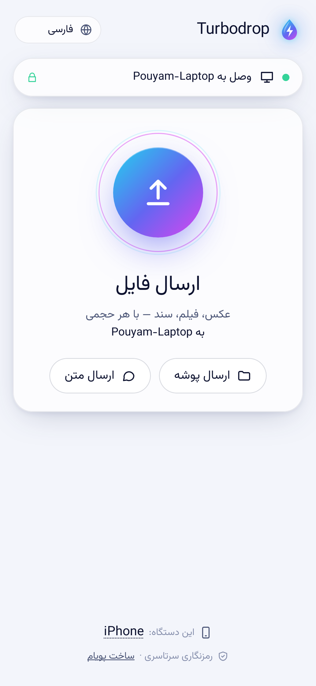
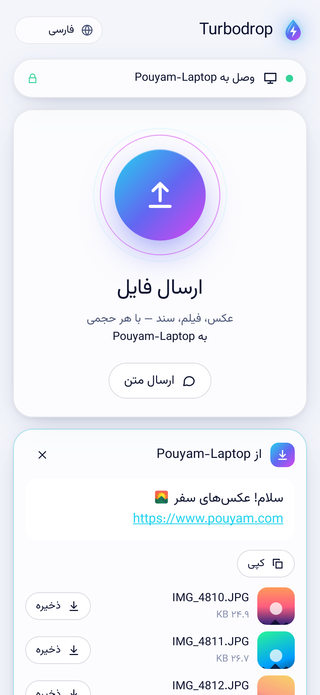
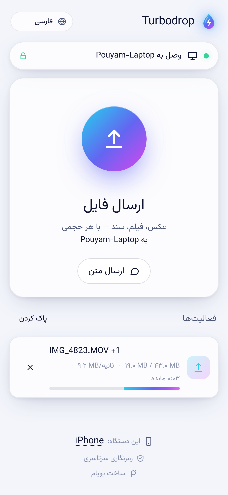

<div dir="rtl">

<div align="center">



# توربودراپ (Turbodrop)

**مثل ایردراپ، برای همهٔ دستگاه‌ها؛ روی آیفون هیچ چیزی لازم نیست نصب شود.**

فایل، پوشه، عکس، فیلم و متن را بین **ویندوز، آیفون، آیپد، اندروید، مک و لینوکس** از طریق همان وای‌فای خانه یا محل کار جابه‌جا کنید.
گوشی فقط کد QR را اسکن می‌کند و بعد، داخل مرورگر، هم فایل می‌فرستد و هم می‌گیرد: بدون اپ، بدون حساب کاربری، بدون فضای ابری و حتی بدون اینترنت.
همه‌چیز رمزنگاری سرتاسری دارد، انتقال‌ها اگر قطع شوند از همان‌جا ادامه پیدا می‌کنند و سرعت فقط به شبکهٔ شما بستگی دارد.

[**دانلود برای ویندوز**](https://github.com/pouyamsmartcity/turbodrop/releases/latest) ·
[وب‌سایت](https://pouyamsmartcity.github.io/turbodrop/) ·
[English](README.md) ·
[پروتکل](docs/PROTOCOL.md) ·
[امنیت](SECURITY.md)



</div>

## چرا توربودراپ؟

ایردراپ عالی است، تا وقتی که یک طرف ماجرا ویندوز یا اندروید باشد. ابزارهای متن‌باز موجود هم خوب‌اند، ولی هر کدام جایی کم می‌آورند:
طرف مقابل اول باید اپ نصب کند، آیفون فقط می‌تواند فایل‌ها را یکی‌یکی دانلود کند، یک سرور عمومی لازم است، یا اگر وای‌فای لحظه‌ای قطع شود، فیلم ۴ گیگابایتی باید از اول فرستاده شود.

جواب توربودراپ ساده است: **یک برنامهٔ زیبا روی کامپیوتر، و روی گوشی هیچ چیز.**

<table>
<tr>
<td width="33%"></td>
<td width="33%"></td>
<td width="33%"></td>
</tr>
<tr>
<td align="center">اسکن QR و اتصال</td>
<td align="center">عکس‌ها با پیش‌نمایش می‌رسند</td>
<td align="center">ارسال فیلم با تمام سرعت وای‌فای</td>
</tr>
</table>

## امکانات

- 📱 **گوشی بدون نصب، در هر دو جهت.** هر مرورگری (سافاری، کروم، فایرفاکس، سامسونگ) بعد از اسکن QR هم می‌فرستد و هم دریافت می‌کند. روی آیفون هم بدون اپ‌استور کار می‌کند.
- 🔒 **رمزنگاری سرتاسری.** همهٔ داده‌ها، یعنی تکه‌های فایل، اسم فایل‌ها و پیام‌ها، با XChaCha20-Poly1305 رمز می‌شوند. کلید مرورگر داخل بخش `#` لینکِ کد QR است و مرورگر هیچ‌وقت این بخش را روی شبکه نمی‌فرستد. دو کامپیوتر با X25519 به هم وصل می‌شوند و یک کد ۴ ایموجی‌ای نشان می‌دهند که می‌شود روی هر دو صفحه با هم مقایسه کرد.
- ⏯️ **ادامهٔ انتقال بعد از قطعی.** اگر از محدودهٔ وای‌فای بیرون بروید، گوشی قفل شود یا حتی برنامه بسته و باز شود، انتقال از آخرین تکه ادامه پیدا می‌کند و از صفر شروع نمی‌شود.
- ♻️ **تشخیص فایل تکراری.** فایلی که از قبل در مقصد هست دوباره فرستاده نمی‌شود. اگر فایلی با همان اسم ولی محتوای متفاوت برسد، با اسم `name (2).ext` ذخیره می‌شود و هیچ‌وقت روی فایل قبلی نوشته نمی‌شود.
- 📁 **ارسال پوشه با همان ساختار** (مثلاً `سفر شمال/روز ۱/IMG_0001.JPG`).
- 🗜️ **ذخیرهٔ همه با یک ZIP روی گوشی**، به‌جای این‌که پنجاه بار «دانلود شود؟» را تأیید کنید.
- 🖼️ **پیش‌نمایش عکس و فیلم روی گوشی.** برای ذخیره در گالری، انگشت را روی عکس نگه دارید.
- 💬 **متن، لینک و کلیپ‌بورد.** رمز وای‌فای یا یک لینک را با یک کلیک بفرستید؛ لینک باز می‌شود و متن کپی.
- 📡 **پیدا کردن خودکار کامپیوترهای نزدیک**، یا افزودن دستی با آدرس IP. برای هر شبکه یک کد QR جدا نمایش داده می‌شود: وای‌فای، کابل شبکه، هات‌اسپات کامپیوتر و حتی Tailscale.
- 👥 **چند گوشی هم‌زمان.** با یک کد QR چند گوشی وصل می‌شوند و می‌توانید به یکی یا به همه بفرستید.
- ✅ **قبول یا رد هر درخواست**، با گزینهٔ «همیشه از این دستگاه قبول کن» برای دستگاه‌های خودتان.
- 🪟 **سازگار با حال‌وهوای ویندوز ۱۱:** پس‌زمینهٔ شیشه‌ای Mica، پوستهٔ روشن و تیره، پنج رنگ اصلی، آیکون کنار ساعت ویندوز، اجرا همراه با ویندوز، **گزینهٔ «ارسال با توربودراپ» در منوی راست‌کلیک**، اعلان‌های ویندوز، و جلوگیری از خواب رفتن کامپیوتر در حین انتقال.
- 🧭 **تاریخچهٔ انتقال‌ها** با دکمه‌های «باز کردن» و «نمایش در پوشه».
- 🌍 **۱۲ زبان** با پشتیبانی کامل راست‌به‌چپ: فارسی، عربی، انگلیسی، ترکی، اسپانیایی، فرانسوی، آلمانی، پرتغالی، روسی، هندی، چینی و ژاپنی. در رابط فارسی، اعداد هم فارسی نمایش داده می‌شوند.
- ⌨️ **خط فرمان واقعی** برای ویندوز، مک و لینوکس، با کد QR داخل خود ترمینال و خروجی JSON برای اسکریپت‌نویسی.
- 🪶 **سبک و سریع.** نصب‌کنندهٔ ویندوز فقط **حدود ۴ مگابایت** است (برنامه‌های Electron بین ۸۰ تا ۱۵۰ مگابایت‌اند) و نسخهٔ خط فرمان با رابط وب گوشی حدود ۶ مگابایت. انتقال ۱ گیگابایت بین دو کامپیوتر روی یک دستگاه، با رمزنگاری، ۷٫۵ ثانیه طول کشید (حدود ۱۳۶ مگابایت در ثانیه). این از سرعت شبکهٔ گیگابیتی بیشتر است، پس محدودیت فقط شبکهٔ شماست.
- 🕊️ **حریم خصوصی از پایه.** حساب کاربری، ردیابی و سرور واسط وجود ندارد. فایل‌ها هیچ‌وقت از شبکهٔ شما بیرون نمی‌روند.

## راهنمای استفاده

### ۱) نصب روی ویندوز

1. فایل **`Turbodrop_<نسخه>_x64-setup.exe`** را از [صفحهٔ Releases](https://github.com/pouyamsmartcity/turbodrop/releases/latest) دانلود و اجرا کنید. نصب فقط برای کاربر فعلی انجام می‌شود و دسترسی ادمین نمی‌خواهد.
2. بار اول، فایروال ویندوز می‌پرسد که توربودراپ اجازهٔ استفاده از شبکه را دارد یا نه. گزینهٔ **Private networks** را تیک بزنید و Allow را بزنید.
3. چون نصب‌کننده هنوز امضای دیجیتال ندارد، ممکن است پیام «Windows protected your PC» نمایش داده شود. روی **More info** و بعد **Run anyway** بزنید. همهٔ نسخه‌ها را GitHub Actions مستقیم از همین مخزن می‌سازد.

### ۲) وصل کردن آیفون یا اندروید

1. گوشی و کامپیوتر باید به **یک وای‌فای** وصل باشند. اگر وای‌فای نیست، گوشی را به هات‌اسپات کامپیوتر وصل کنید.
2. در توربودراپ به بخش **«گوشی»** بروید.
3. با **دوربین** گوشی کد QR را اسکن کنید و لینک را باز کنید. کار تمام است.
4. نکته: صفحه را به Home Screen اضافه کنید تا دفعهٔ بعد با یک لمس باز شود. وصل شدن دوباره خودکار است.

### ۳) فرستادن فایل

- **از کامپیوتر:** فایل‌ها یا پوشه‌ها را داخل پنجره بکشید، یا روی فایل در ویندوز راست‌کلیک کنید و «ارسال با توربودراپ» را بزنید. بعد دستگاه مقصد را انتخاب کنید (گوشی، کامپیوتر دیگر یا «همهٔ گوشی‌های وصل»).
- **از گوشی:** دکمهٔ بزرگ «ارسال فایل» را بزنید و عکس، فیلم یا فایل را انتخاب کنید. فایل‌ها در پوشهٔ `Downloads\Turbodrop` کامپیوتر ذخیره می‌شوند.
- **متن و لینک:** «ارسال متن» یا «ارسال کلیپ‌بورد».

### ۴) اگر وسط کار وصل نشد یا قطع شد

- **قطع شد؟** کاری لازم نیست. تا ۵ دقیقه خودش دوباره تلاش می‌کند. اگر صفحه بسته شد، همان فایل را دوباره انتخاب کنید تا از همان‌جایی که مانده بود ادامه پیدا کند.
- **کامپیوتر پیدا نمی‌شود؟** بعضی روترها یا وای‌فای‌های مهمان، دستگاه‌ها را از هم جدا می‌کنند (AP Isolation). این گزینه را در روتر خاموش کنید، یا از هات‌اسپات کامپیوتر استفاده کنید.
- **وی‌پی‌ان روشن است؟** وی‌پی‌ان روی گوشی می‌تواند جلوی دسترسی به شبکهٔ محلی را بگیرد. موقع انتقال خاموشش کنید.
- **کد QR را کسی دیده؟** در بخش «گوشی»، «عوض کردن کد QR» را بزنید تا همهٔ اتصال‌های قبلی قطع شوند.

### ۵) مک و لینوکس

نسخهٔ دسکتاپ (`.dmg`، `.AppImage` و `.deb`) و نسخهٔ خط فرمان در صفحهٔ Releases هستند. نمونه دستورها:

<div dir="ltr">

```bash
turbodrop receive                       # کد QR در ترمینال؛ گوشی‌ها و کامپیوترها می‌توانند بفرستند
turbodrop share photo.jpg Videos/       # گوشی‌ای که اسکن کند این فایل‌ها را می‌گیرد
turbodrop send report.pdf --to Laptop   # ارسال به یک توربودراپ دیگر در شبکه
turbodrop devices                       # چه دستگاه‌هایی در شبکه هستند؟
```

</div>

## مقایسه با بقیه

جدول کامل مقایسه با LocalSend و PairDrop/Snapdrop، همراه با لینک به گزارش‌های خود آن پروژه‌ها، در [README انگلیسی](README.md#how-it-compares) هست. خلاصه‌اش:
- LocalSend روی هر دو طرف اپ لازم دارد و در مرورگر فقط دانلود فایل‌به‌فایل ممکن است.
- PairDrop به سرور اینترنتی وابسته است.
- هیچ‌کدام بعد از قطعی، انتقال را از همان‌جا ادامه نمی‌دهند.

## امنیت به زبان ساده

- کلید رمزنگاری فقط داخل کد QR است، یعنی هر کسی که کد را روی صفحهٔ شما ببیند می‌تواند وصل شود. برای همین دکمهٔ «عوض کردن کد QR» گذاشته شده.
- کسی که فقط ترافیک وای‌فای را شنود کند، نه محتوای فایل‌ها را می‌بیند و نه اسمشان را.
- یک محدودیت را صادقانه بگوییم: چون صفحهٔ گوشی با http ساده از خود کامپیوتر بارگذاری می‌شود، مهاجمی که **فعالانه** در همان شبکه حمله کند، در تئوری می‌تواند خود صفحه را دست‌کاری کند. در شبکه‌های عمومی و ناامن، فقط بین کامپیوترهایی که توربودراپ نصب دارند منتقل کنید و کد ایموجی را چک کنید. جزئیات کامل در [SECURITY.md](SECURITY.md) است.

## ساخت از روی سورس

<div dir="ltr">

```bash
npm install
npm run build:web
cargo build --release -p turbodrop-cli
npm run desktop:build
```

</div>

تست‌ها: `cargo test` (موتور، ۲۵ تست شامل انتقال واقعی، ادامه بعد از ری‌استارت و جلوگیری از خروج از پوشهٔ دانلود)، `npm run test:web` و `npm run e2e` (Playwright روی **WebKit آیفون**، کروم اندروید و کروم دسکتاپ).

## مجوز

[MIT](LICENSE) © ۲۰۲۶ [پویام](https://www.pouyam.com)

<div align="center">
<sub>ساخته‌شده با ❤️ توسط <a href="https://www.pouyam.com">پویام</a> · Rust، Tauri و Svelte</sub>
<br/>
<sub>AirDrop علامت تجاری Apple Inc. است. توربودراپ پروژه‌ای مستقل است و هیچ ارتباطی با اپل ندارد.</sub>
</div>

</div>
