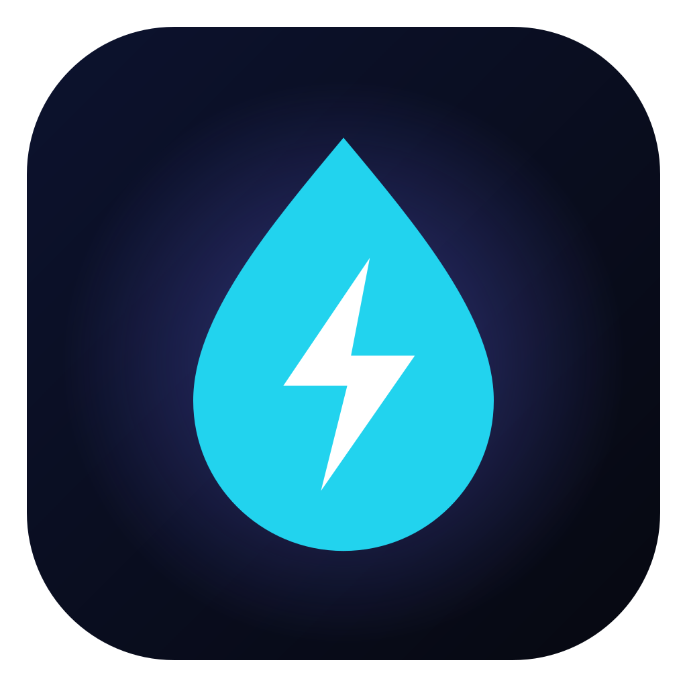
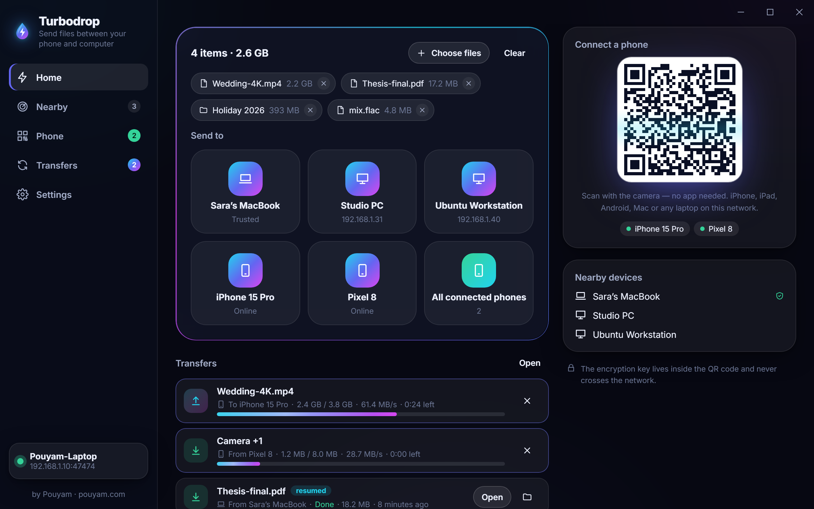
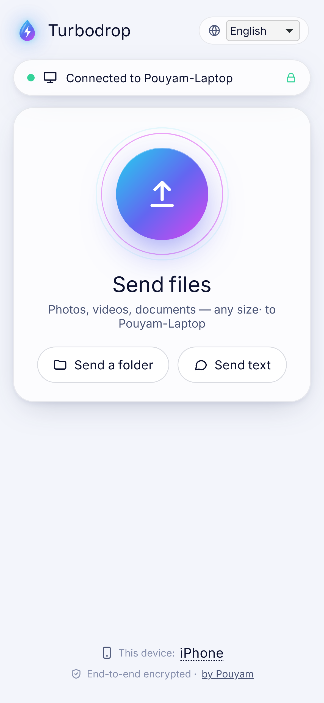
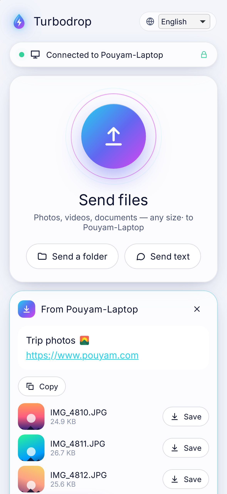
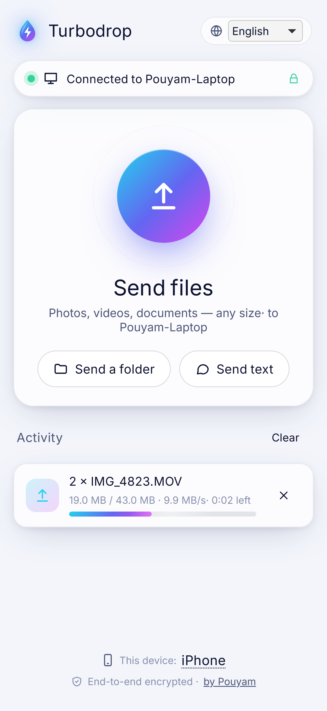
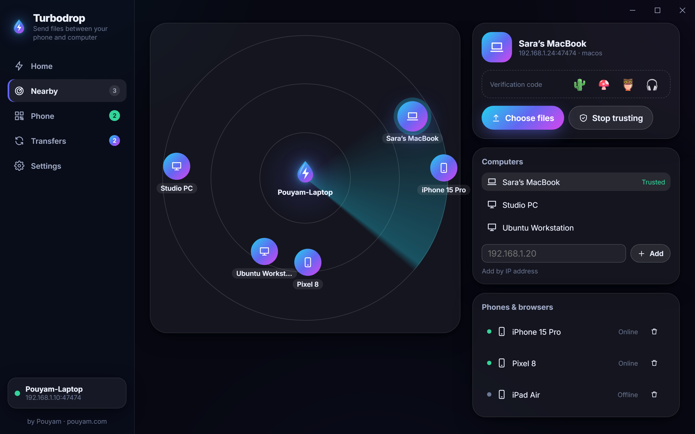
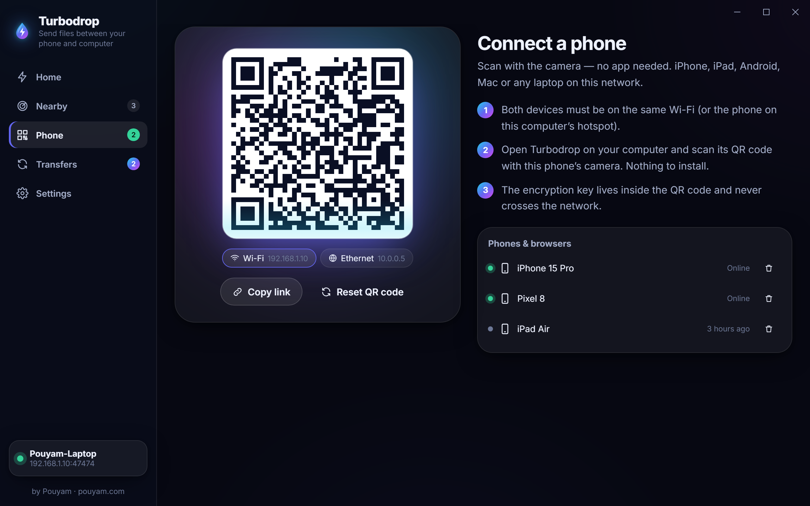
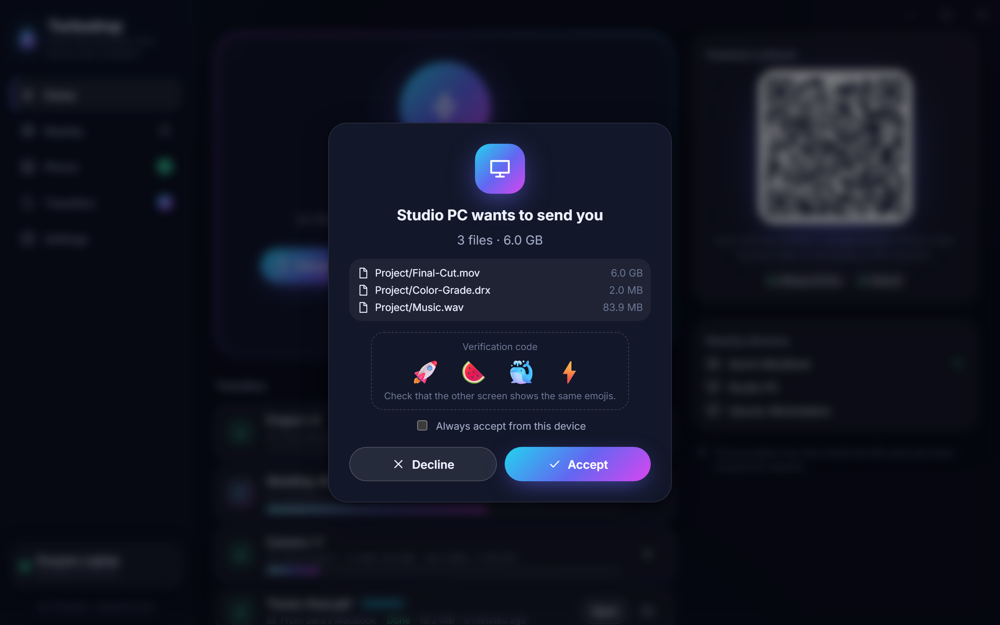
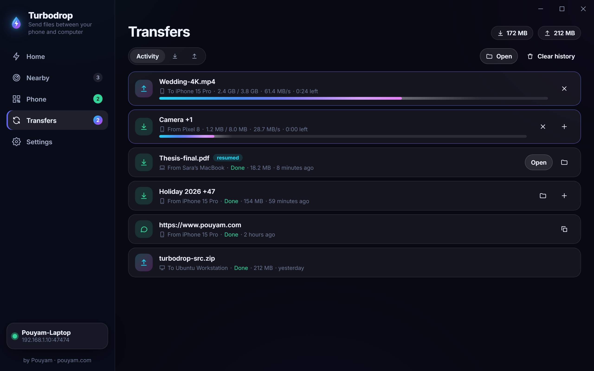
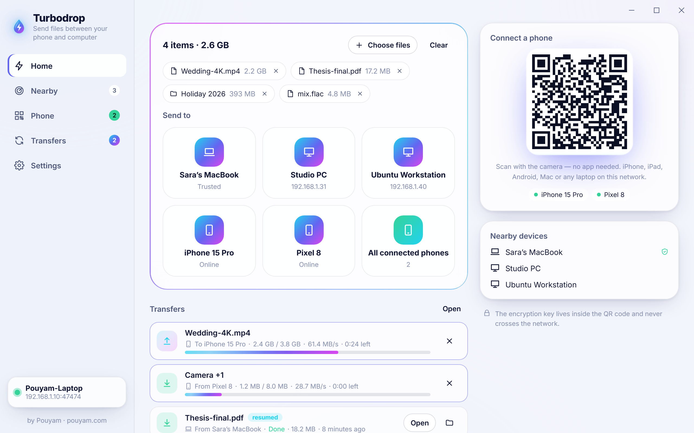

<div align="center">



# Turbodrop

**Like AirDrop, for every device. The iPhone needs nothing installed.**

Send files, folders, photos, videos and text between **Windows, iPhone, iPad, Android, Mac and Linux** over your own Wi‑Fi.
Scan a QR code and the phone can send *and* receive in its browser — no app, no account, no cloud, no internet needed.
End-to-end encrypted, resumable, and fast.

[**Download for Windows**](https://github.com/pouyamsmartcity/turbodrop/releases/latest) ·
[Website](https://pouyamsmartcity.github.io/turbodrop/) ·
[فارسی](README.fa.md) ·
[How it works](docs/PROTOCOL.md) ·
[Security](SECURITY.md)

[](https://github.com/pouyamsmartcity/turbodrop/actions/workflows/ci.yml)
[](LICENSE)




</div>

## Why Turbodrop?

AirDrop is magic — until someone has a Windows PC, an Android phone, or a friend's iPhone. The open-source alternatives are
great, but each one stops short somewhere: the other person has to install an app first, the iPhone can only download one
file at a time, a public server is needed, or a dropped Wi‑Fi connection means starting a 4 GB video from zero.

Turbodrop's answer: **one beautiful app on the computer, nothing at all on the phone.**

<table>
<tr>
<td width="33%"></td>
<td width="33%"></td>
<td width="33%"></td>
</tr>
<tr>
<td align="center">Scan the QR code — connected</td>
<td align="center">Photos arrive with previews</td>
<td align="center">Send a 4K video at full Wi‑Fi speed</td>
</tr>
</table>

## Features

- 📱 **Zero-install phones, both directions.** Any phone or laptop browser (Safari, Chrome, Firefox, Samsung Internet) sends and receives after scanning the QR code. Works on the iPhone without the App Store.
- 🔒 **End-to-end encrypted.** Every byte — file chunks, names, messages — is sealed with XChaCha20-Poly1305. The browser key lives in the QR code's `#fragment`, which browsers never send over the network. Computers pair with X25519 and show a 4-emoji code to compare.
- ⏯️ **Resumable transfers.** Walk out of Wi‑Fi range, lock the phone, even restart the app: the transfer continues from the last chunk instead of starting over.
- ♻️ **Smart duplicates.** Files that are already there are skipped; a changed file with the same name is saved as `name (2).ext` — never overwritten.
- 📁 **Folders keep their structure** (`Holiday 2026/day 1/IMG_0001.JPG`), on every side.
- 🗜️ **Save all as ZIP on the phone** — one tap instead of fifty “Download?” prompts.
- 🖼️ **Photo and video previews** on the phone, with long-press to save to Photos.
- 💬 **Text, links and clipboard.** Send a Wi‑Fi password or a link in one click; links open, text copies.
- 📡 **Finds nearby computers automatically** (UDP multicast), or add one by IP. Shows a QR code for each network: Wi‑Fi, Ethernet, the PC's hotspot, even Tailscale.
- 👥 **Several phones at once.** One QR code, many phones; send to one or to all of them.
- ✅ **Approve or decline**, with “always accept from this device” for your own machines.
- 🪟 **Feels at home on Windows 11:** Mica glass, light/dark, five accent colors, tray icon, start with Windows, **“Send with Turbodrop” in the Explorer right-click menu**, native notifications, keeps the PC awake during transfers.
- 🧭 **History** with Open and Show in folder.
- 🌍 **12 languages** with full right-to-left support: English, فارسی, العربية, Türkçe, Español, Français, Deutsch, Português, Русский, हिन्दी, 中文, 日本語.
- ⌨️ **A real CLI** for Windows, macOS and Linux with a QR code right in the terminal and JSON output for scripts.
- 🪶 **Small and fast.** A single Rust engine; the CLI is ~6 MB with the phone web app inside. 1 GiB computer-to-computer over loopback in 7.5 s (≈136 MiB/s, encryption included) — faster than gigabit Ethernet, so your network is the limit.
- 🕊️ **Private by design.** No accounts, no telemetry, no servers. Your files never leave your network.

## How it compares

Honest, as of November 2026. Links point to the projects' own issue trackers.

| | **Turbodrop** | LocalSend | PairDrop / Snapdrop |
|---|---|---|---|
| iPhone/Android **without installing anything** | ✅ send **and** receive | ⚠️ “Share via link”: the browser can only download, one file at a time | ✅ |
| Works with **no internet** (just Wi‑Fi) | ✅ | ✅ | ❌ needs its signaling server ([self-host](https://github.com/schlagmichdoch/PairDrop) possible) |
| **Resume** after a dropped connection | ✅ | ❌ [requested](https://github.com/localsend/localsend/issues/1191) | ❌ [large files disconnect](https://github.com/schlagmichdoch/PairDrop/issues/120) |
| **Skip** files already on the receiver | ✅ | ❌ [requested](https://github.com/localsend/localsend/issues/443) | ❌ |
| Send **folders** | ✅ | ✅ | ❌ [requested](https://github.com/schlagmichdoch/PairDrop/issues/290) |
| **Save all as ZIP** on the phone | ✅ | ❌ | ❌ |
| Encryption on the browser path | ✅ E2E, no certificate warnings | ⚠️ optional HTTPS with a self-signed-certificate warning | ✅ WebRTC (DTLS) |
| Explorer right-click “Send with…” | ✅ | — | ❌ |
| Terminal QR code + JSON CLI | ✅ | — | ❌ |

LocalSend is a fantastic project with apps in every store; if both sides already have it, use it. Turbodrop is for when the other side has *nothing* — or when the transfer is too big to start over.

## Get it

### Windows (the flagship app)

Download **`Turbodrop_x64-setup.exe`** from [Releases](https://github.com/pouyamsmartcity/turbodrop/releases/latest) and run it. It installs for your user only (no admin). On first launch Windows Firewall asks whether Turbodrop may use the network — allow **Private networks**.

> The installer is not code-signed yet, so SmartScreen may say “Windows protected your PC”. Click **More info → Run anyway**. Every release is built by [GitHub Actions](.github/workflows/release.yml) from this repository.

### iPhone, iPad, Android

Nothing to install. Open Turbodrop on the computer, go to **Phone**, and scan the QR code with the camera. Bookmark the page or add it to the Home Screen for one-tap access next time.

### macOS and Linux

- **Desktop app:** `.dmg`, `.AppImage` and `.deb` builds are on the [Releases](https://github.com/pouyamsmartcity/turbodrop/releases/latest) page (the macOS build is not notarized yet: right-click → Open the first time).
- **CLI:** download `turbodrop-<os>-<arch>` from Releases, or build it: `cargo install --git https://github.com/pouyamsmartcity/turbodrop turbodrop-cli`.

### Command line

```bash
turbodrop receive                       # QR code in the terminal; phones and computers can send to you
turbodrop share photo.jpg Videos/       # the phone that scans the code receives these
turbodrop send report.pdf --to Laptop   # to a nearby Turbodrop device (name, id or IP)
turbodrop devices                       # who is around?
turbodrop receive --json                # one JSON event per line, for scripts
```

## More screenshots

| | |
|---|---|
|  |  |
|  |  |
|  |  |

## How it works

```
 ┌──────────── Windows / macOS / Linux ────────────┐            ┌──────── iPhone / Android ────────┐
 │  Turbodrop app  ── turbodrop-core (Rust) ──┐     │  QR code   │  Safari / Chrome                 │
 │                  • HTTP API + web client   │◄────┼────────────┤  web client (served by the PC)   │
 │                  • UDP multicast discovery │     │  Wi‑Fi     │  XChaCha20-Poly1305 in JS        │
 │                  • resumable chunk store   │◄────┼──────┐     └──────────────────────────────────┘
 └────────────────────────────────────────────┘     │      │
                                                     │      └──── another Turbodrop computer (X25519 + emoji code)
```

- Files move in **4 MiB chunks**. Each chunk is sealed with its transfer, file and position in the associated data, so chunks can't be swapped, replayed into another file, or silently dropped.
- The receiver keeps a `.tdpart` file and a small journal; a later offer of the same file continues at the next chunk.
- The phone talks plain HTTP on your LAN — no certificate warnings — while everything inside is end-to-end encrypted.

Full details: [docs/PROTOCOL.md](docs/PROTOCOL.md) · threat model: [SECURITY.md](SECURITY.md).

## Build from source

Requirements: Rust 1.80+, Node 20+. Windows also needs the MSVC build tools and WebView2 (preinstalled on Windows 11); Linux needs the [Tauri prerequisites](https://v2.tauri.app/start/prerequisites/).

```bash
npm install
npm run build:web                     # the phone web app (embedded into the binaries)
cargo build --release -p turbodrop-cli
npm run desktop:build                 # the desktop app + installer
```

Tests: `cargo test` (engine, 25 tests incl. end-to-end transfers, resume after restart, path-traversal and forgery checks), `npm run test:web` (crypto interop vectors shared with Rust, ZIP), and `npm run e2e` (Playwright: the real binary against **WebKit/iPhone**, Android Chrome and desktop Chrome — uploads, downloads, ZIP, dropped-connection resume, RTL).

## Roadmap

- Native Android app (same Rust engine) with share-sheet integration
- iOS app with the share sheet and background receive
- Signed Windows installer, `winget` and Microsoft Store
- LocalSend protocol bridge, Bluetooth/Wi‑Fi Direct pairing

Ideas and bug reports are welcome — see [CONTRIBUTING.md](CONTRIBUTING.md).

## License

[MIT](LICENSE) © 2026 [Pouyam](https://www.pouyam.com).

<div align="center">
<sub>Made with ❤️ by <a href="https://www.pouyam.com">Pouyam</a> · built with Rust, Tauri and Svelte</sub>
<br/>
<sub>AirDrop is a trademark of Apple Inc. Turbodrop is an independent project, not affiliated with Apple.</sub>
</div>
